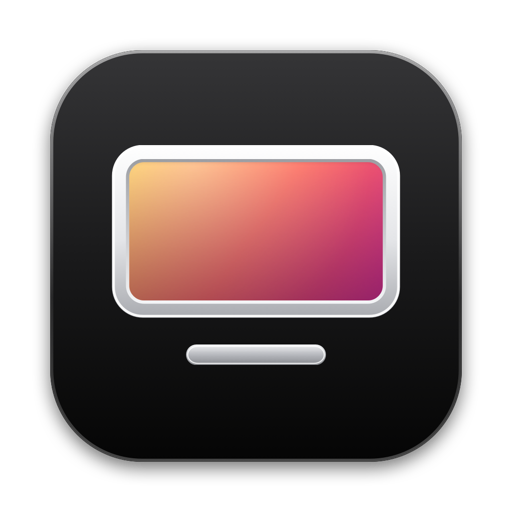
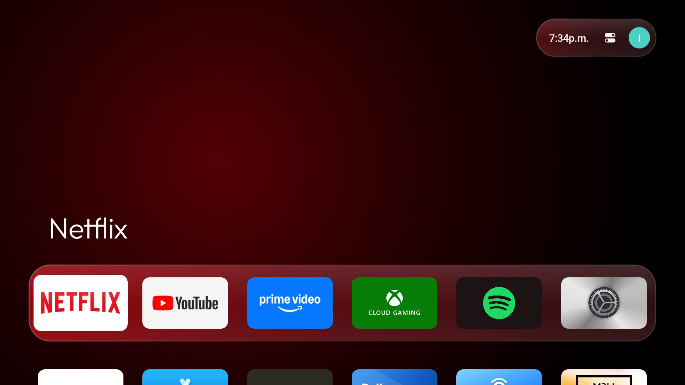
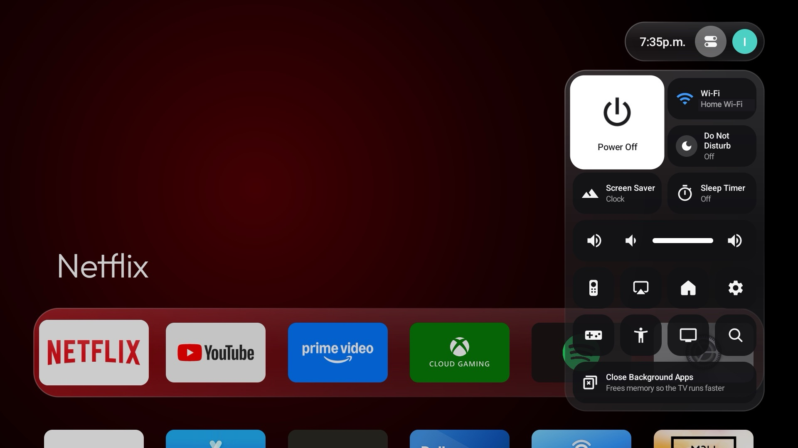
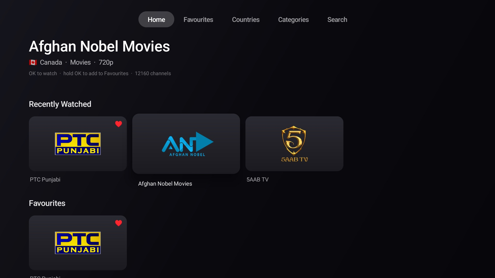
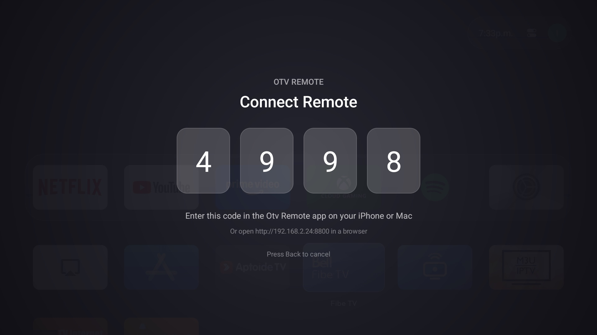
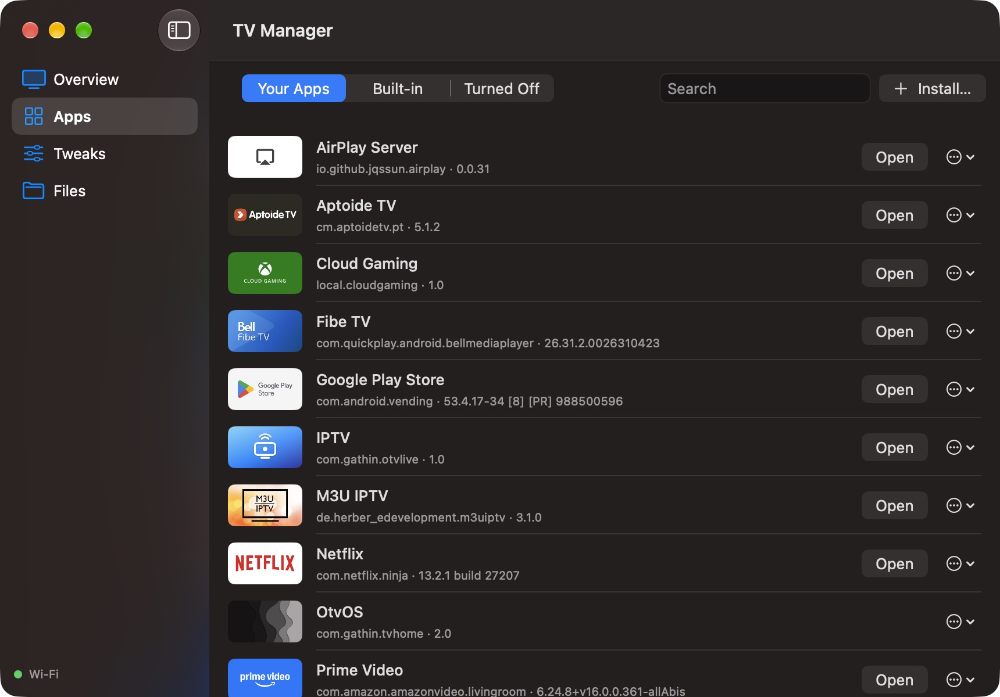
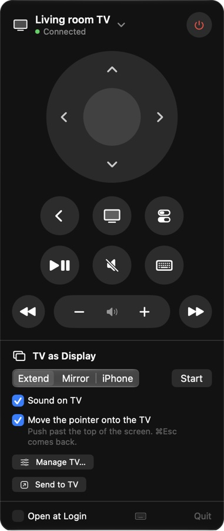

<p align="center">
  
</p>

<h1 align="center">OpenTV</h1>

<p align="center">
  <b>Your Android TV, reimagined as an Apple TV.</b><br>
  OtvOS replaces the home screen of any Android TV or Google TV with a fast, tvOS-style one,<br>
  and brings an iPhone remote, AirPlay, Apple Home and a Mac that works with your TV.
</p>

<p align="center">
  <a href="https://github.com/harkhowalia-1/OpenTV/releases/latest/download/OpenTV-Installer.zip"><b>Download OpenTV Installer for Mac</b></a>
</p>

<p align="center">
  
  
  
  
  
  
</p>

<p align="center">
  <a href="https://harkhowalia-1.github.io/OpenTV/"><b>Website</b></a> ·
  <a href="#whats-inside">What's inside</a> ·
  <a href="#install">Install</a> ·
  <a href="#works-with">Works with</a> ·
  <a href="#build-from-source">Build from source</a>
</p>

## What's inside

<table>
  <tr>
    <td width="50%" valign="top">
      
      <h3>OtvOS</h3>
      A tvOS-style home screen: a top shelf, app tiles that lift and glow under focus, the focused app's colour across the screen, profiles linked to Google accounts, an App Store and Settings in the same style, and a clock screensaver.
    </td>
    <td width="50%" valign="top">
      
      <h3>Control Center</h3>
      Hold Home on the remote. Power, Wi-Fi, Do Not Disturb, screensaver, sleep timer, volume, AirPlay, Apple Home, and <b>Close Background Apps</b> to free memory on small TVs.
    </td>
  </tr>
  <tr>
    <td width="50%" valign="top">
      
      <h3>IPTV</h3>
      Free live TV from around the world, in an Apple TV-style app: rows by category, every country, search, favourites (hold OK) and recently watched. Up and down change channel while watching.
    </td>
    <td width="50%" valign="top">
      
      <h3>Otv Remote</h3>
      Your iPhone is the remote: touch surface, keyboard, volume buttons, Control Center and Lock Screen controls, Siri and Shortcuts, and Send to TV from the Share sheet. Pair once with the code on the TV.
    </td>
  </tr>
  <tr>
    <td width="50%" valign="top">
      
      <h3>TV Manager on the Mac</h3>
      Every app on the TV with its picture: open, stop, clear, turn off or uninstall, and drag an <code>.apk</code> from your Mac to install it. Tweaks for animations, resolution, interface size, screensaver and sleep, private DNS and HDMI-CEC. Screenshots, files, restart.
    </td>
    <td width="50%" valign="top">
      
      <h3>OpenTV Companion</h3>
      Lives in the Mac's menu bar: a remote, <b>TV as Display</b> (extend or mirror your Mac onto the TV with very low latency), <b>the Mac's pointer on the TV</b> (push it past the top of the screen), and <b>Send to TV</b> for the browser tab or video you're watching. Over Wi-Fi or a USB-C cable.
    </td>
  </tr>
</table>

Also on the TV: **AirPlay** from iPhone, iPad and Mac (the open-source UxPlay receiver), and **Apple Home**: the TV appears in the Home app, so Siri and the Apple TV Remote in Control Center can turn it on and off and change the volume.

## Install

1. On the TV, turn on **Developer options** (Settings › System › About, press *Android TV OS build* seven times), then **USB debugging**, and **Wireless debugging** on Android 11 and later (or *Network debugging* on older TVs).
2. Download **[OpenTV Installer](https://github.com/harkhowalia-1/OpenTV/releases/latest/download/OpenTV-Installer.zip)**, unzip it, and open it. The first time, right-click it and choose **Open**.
3. Pick your TV (it finds it on your Wi-Fi, or plug it in with USB-C), choose what to install, and press **Install**.

The installer downloads the newest release every time, so running it again updates everything. It gets Android's connection tools by itself if your Mac doesn't have them. **Restore Original TV** puts the TV's own home screen back and removes OpenTV.

**Otv Remote** for iPhone: build it from `tv-remote-apps` (see below) until it's on the App Store.

## Works with

OpenTV runs on Android TV and Google TV from **Android 8 (Oreo)** onward: Chromecast with Google TV (HD and 4K), Google TV Streamer, NVIDIA Shield, Sony, TCL, Hisense, Philips and Xiaomi TVs and boxes, and other certified Android TV devices. It was built on a Chromecast with Google TV (HD), 1.4 GB of memory, so it is made to stay fast on small chips.

Some features depend on the TV: wireless debugging needs Android 11 or later (use a USB cable or network debugging on older TVs), and some TVs don't allow apps to replace the home screen.

## Build from source

Requirements: JDK 17 and the Android SDK for the TV, Xcode 26 and [XcodeGen](https://github.com/yonaskolb/XcodeGen) for the Mac and iPhone.

```sh
git clone https://github.com/harkhowalia-1/OpenTV.git
cd OpenTV
scripts/install-tv.sh                 # builds OtvOS and IPTV and sets them up on the TV connected over adb
cd tv-remote-apps && xcodegen generate && open TVRemote.xcodeproj
```

Schemes: **TVRemote** (Otv Remote, iPhone), **TVRemoteMac** (OpenTV Companion), **OpenTVInstaller**. To run on your own devices, change `DEVELOPMENT_TEAM` in `tv-remote-apps/project.yml`. `scripts/release.sh <version>` builds everything and publishes a release the installer picks up.

```
launcher-source/   OtvOS, the TV's home screen and services (app) and IPTV (otvlive)
tv-remote-apps/    Otv Remote (iOS), OpenTV Companion and OpenTV Installer (macOS)
cloud-gaming/      a small Xbox Cloud Gaming app for the TV
scripts/           release and developer install scripts
restore.sh         puts a TV back to stock from the command line
```

## Privacy

Everything stays on your network. The TV, your iPhone and your Mac talk to each other directly; pairing codes and tokens never leave your home. Nothing is collected and there are no accounts.

## Credits

Built with [scrcpy](https://github.com/Genymobile/scrcpy)'s device server (Apache 2.0), [HAP-Java](https://github.com/hap-java/HAP-Java) (MIT), [ZXing](https://github.com/zxing/zxing) (Apache 2.0), [AndroidX Media3](https://github.com/androidx/media) (Apache 2.0) and the [Outfit](https://github.com/Outfitio/Outfit-Fonts) font (OFL). The AirPlay receiver is [UxPlay for Android](https://f-droid.org/packages/io.github.jqssun.airplay/) (GPL-3.0), downloaded from F-Droid by the installer. The home screen started from an MIT-licensed launcher (see `launcher-source/LICENSE`).

## Support

If you enjoy this project, you can support me here:

<a href="https://buymeacoffee.com/harkhowalia"></a>

---

<sub>OpenTV is an independent project and is not affiliated with, endorsed by or sponsored by Apple Inc. or Google LLC. Apple TV, tvOS, AirPlay, Apple Home, iPhone, iPad, Mac and Siri are trademarks of Apple Inc. Android TV, Google TV and Chromecast are trademarks of Google LLC. IPTV only lists free channels that broadcasters publish openly; OpenTV does not host any streams.</sub>

<sub>Copyright © 2026 Harkhowalia. All rights reserved.</sub>
