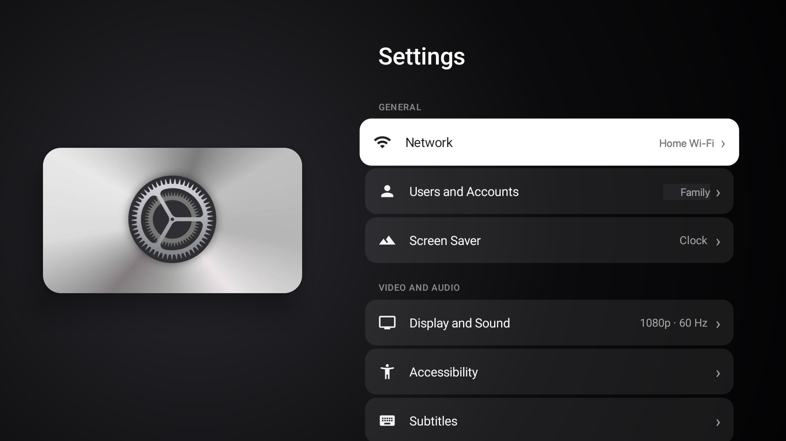
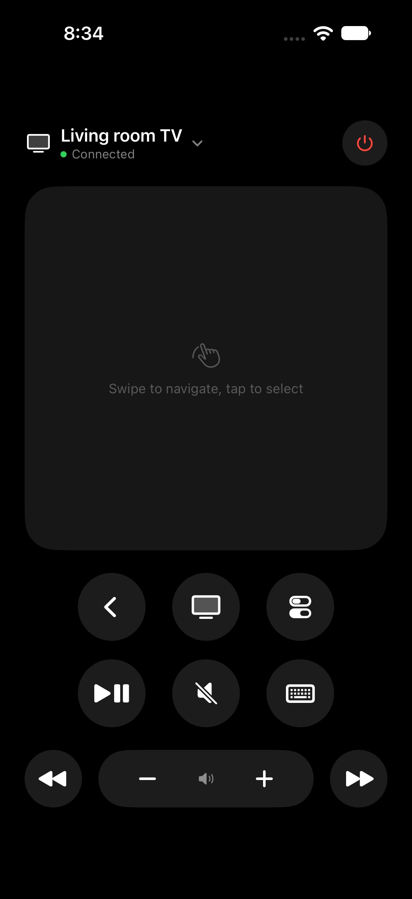

<p align="center">
  
</p>

<h1 align="center">OpenTV</h1>

<p align="center">
  <b>Your Android TV experience, reimagined.</b><br>
  A fast, beautiful home screen for any Android TV or Google TV, your iPhone as the remote,<br>
  AirPlay, Apple Home and Siri, live TV from around the world, and a Mac that works hand in hand with your TV.
</p>

<p align="center">
  <a href="https://github.com/harkhowalia-1/OpenTV/releases/latest/download/OpenTV-Installer.zip"><b>Mac installer</b></a> ·
  <a href="https://github.com/harkhowalia-1/OpenTV/releases/latest/download/Otv-Remote.ipa"><b>iPhone remote (IPA)</b></a> ·
  <a href="https://github.com/harkhowalia-1/OpenTV/releases/latest/download/OtvOS.apk"><b>OtvOS for the TV (APK)</b></a> ·
  <a href="https://github.com/harkhowalia-1/OpenTV/releases/latest/download/IPTV.apk"><b>IPTV (APK)</b></a>
</p>

<p align="center">
  
  
  
  
  
  
</p>

<p align="center">
  <a href="https://harkhowalia-1.github.io/OpenTV/"><b>Website</b></a> ·
  <a href="#on-the-tv">On the TV</a> ·
  <a href="#with-your-iphone">iPhone</a> ·
  <a href="#with-your-mac">Mac</a> ·
  <a href="#install">Install</a> ·
  <a href="#credits">Credits</a>
</p>

## On the TV

<table>
  <tr>
    <td width="50%" valign="top">
      
      <h3>OtvOS home screen</h3>
      A top shelf for your favourite apps, tiles that lift and glow under focus, and the focused app's colour washing across the screen. Profiles follow the Google accounts on the TV.
    </td>
    <td width="50%" valign="top">
      
      <h3>Control Center</h3>
      Hold Home: power and sleep, sleep timer, Wi-Fi, Do Not Disturb, screensaver, volume, AirPlay, Apple Home and <b>Close Background Apps</b>, which frees memory in a few seconds.
    </td>
  </tr>
  <tr>
    <td width="50%" valign="top">
      
      <h3>IPTV</h3>
      Over 12,000 free live channels from almost every country: rows by category, every country, search, favourites (hold OK) and recently watched. Up and down change channel while you watch.
    </td>
    <td width="50%" valign="top">
      
      <h3>Settings and App Store</h3>
      Settings and an App Store in the same design, a clock screensaver, a Connect Remote screen with a four-digit code, and a sleep timer that turns the TV off for you.
    </td>
  </tr>
</table>

- **AirPlay** from iPhone, iPad and Mac, with the open-source UxPlay receiver.
- **Apple Home and Siri**: the TV appears in the Home app. Turn it on and off, change the volume, and use the remote in your iPhone's Control Center.
- **Fast on small chips**: built and tuned on a Chromecast with 1.4 GB of memory. One switch turns off the Google TV extras that run in the background.

## With your iPhone

<table>
  <tr>
    <td width="34%" valign="top"></td>
    <td valign="top">
      <h3>Otv Remote</h3>
      <ul>
        <li>A touch surface and buttons: swipe to move, tap to select, Back, Home, Control Center, play and pause, mute, skip.</li>
        <li>The iPhone's volume buttons change the TV's volume while the app is open.</li>
        <li>Type on the TV with the iPhone's keyboard.</li>
        <li>Controls for Control Center and the Lock Screen, Siri and Shortcuts actions.</li>
        <li><b>Send to TV</b> from the Share sheet: YouTube, Netflix, Spotify, video links and web pages open on the TV.</li>
        <li>Pairs once with the code on the TV, reconnects by itself, and can wake the TV. Any number of phones and Macs can be connected at once.</li>
      </ul>
    </td>
  </tr>
</table>

## With your Mac

<table>
  <tr>
    <td width="60%" valign="top"></td>
    <td valign="top"></td>
  </tr>
</table>

**OpenTV Companion** lives in the menu bar; click it in the Dock for the TV Manager.

- **TV as Display**: extend your Mac onto the TV as a second screen, or mirror it, or put iPhone Mirroring on the TV. Hardware H.264 with adaptive bitrate and the TV drawing the cursor itself, so it stays responsive over Wi-Fi; plug in a USB-C cable and everything goes over the wire.
- **Your Mac's pointer on the TV**: push the cursor past the top of the screen and keep going. Hover to focus, click to open, scroll with two fingers, type with the keyboard. Push into the TV's left edge to go **Back**, its top edge for **Control Center**; a two-finger click is **Home**, and a mouse's back and middle buttons work too.
- **Send to TV**: the tab in Safari, Chrome, Edge, Brave, Arc, Firefox and others, or the video playing in QuickTime or VLC, carries on on the TV at the same moment.
- **TV Manager**: every app on the TV with its picture: open, stop, clear cache or data, turn off, uninstall, or drop an `.apk` from your Mac to install it. Tweaks for animations, resolution and refresh rate, interface size, screensaver and sleep, ad-blocking private DNS and HDMI-CEC. Screenshots to the Desktop, files to the TV, restart.
- Remote with the keyboard: arrow keys, Return, Esc, Space, H for Home, C for Control Center.

## Install

### 1. OpenTV Installer for Mac (easiest)

1. On the TV, turn on **Developer options** (Settings › System › About, press *Android TV OS build* seven times), then **USB debugging**, and **Wireless debugging** on Android 11 and later or *Network debugging* on older TVs.
2. Download **[OpenTV Installer](https://github.com/harkhowalia-1/OpenTV/releases/latest/download/OpenTV-Installer.zip)**, unzip it and open it. The first time, right-click it and choose **Open**.
3. Pick your TV (it finds it on your Wi-Fi, or plug it in with USB-C), choose what to install and press **Install**.

The installer downloads the newest release every time, so running it again updates everything, and it fetches Android's connection tools if your Mac doesn't have them. **Restore Original TV** puts the TV's own home screen back and removes OpenTV.

### 2. From the TV, without a computer

1. Install **Downloader** (by AFTVnews) from the TV's app store.
2. In Downloader, open **`harkhowalia-1.github.io/OpenTV/apk`** and install OtvOS. For IPTV, open **`harkhowalia-1.github.io/OpenTV/iptv`**.
3. On the TV, open Settings › System › Accessibility (or Settings › Accessibility), choose **OtvOS** and turn it on. Pressing Home now opens OtvOS.

A few extras (the Sleep button, Do Not Disturb, Now Playing, waking the TV from the remote) need the installer or the commands below once.

### 3. With adb, from any computer

Download [OtvOS.apk](https://github.com/harkhowalia-1/OpenTV/releases/latest/download/OtvOS.apk) and [IPTV.apk](https://github.com/harkhowalia-1/OpenTV/releases/latest/download/IPTV.apk), connect to the TV (`adb connect <tv-address>` or a USB cable) and run:

```sh
adb install -r -g OtvOS.apk
adb install -r -g IPTV.apk
adb shell settings put secure enabled_accessibility_services com.gathin.tvhome/com.gathin.tvhome.HomeKeyService
adb shell settings put secure accessibility_enabled 1
adb shell cmd package set-home-activity --user 0 com.gathin.tvhome/.MainActivity
adb shell dpm set-active-admin --user 0 com.gathin.tvhome/.SleepAdmin
adb shell cmd notification allow_dnd com.gathin.tvhome
adb shell cmd notification allow_listener com.gathin.tvhome/com.gathin.tvhome.MediaListener
adb shell appops set com.gathin.tvhome TURN_SCREEN_ON allow
```

`restore.sh` undoes it.

### iPhone remote

Install **[Otv-Remote.ipa](https://github.com/harkhowalia-1/OpenTV/releases/latest/download/Otv-Remote.ipa)** with [AltStore](https://altstore.io) or [Sideloadly](https://sideloadly.io), which sign it with your own Apple ID, or build it with Xcode (below).

### OpenTV Companion for Mac on its own

Download [OpenTV-Companion.zip](https://github.com/harkhowalia-1/OpenTV/releases/latest/download/OpenTV-Companion.zip), unzip it into Applications and open it (right-click › Open the first time).

## Works with

Android TV and Google TV from **Android 8 (Oreo)** onward: Chromecast with Google TV (HD and 4K), Google TV Streamer, NVIDIA Shield, Sony, TCL, Hisense, Philips and Xiaomi TVs and boxes, onn. and other certified Android TV devices. Wireless debugging needs Android 11 or later; older TVs use a USB cable or network debugging. Some TVs don't let apps replace the home screen.

## Build from source

JDK 17 and the Android SDK for the TV; Xcode 26 and [XcodeGen](https://github.com/yonaskolb/XcodeGen) for the Mac and iPhone.

```sh
git clone https://github.com/harkhowalia-1/OpenTV.git
cd OpenTV
scripts/install-tv.sh            # builds OtvOS and IPTV and sets them up on the TV connected over adb
cd tv-remote-apps && xcodegen && open TVRemote.xcodeproj
```

Schemes: **TVRemote** (Otv Remote), **TVRemoteMac** (OpenTV Companion), **OpenTVInstaller**. To run on your own devices, change `DEVELOPMENT_TEAM` in `tv-remote-apps/project.yml`. `scripts/release.sh <version>` builds everything and publishes the release the installer downloads.

```
launcher-source/   OtvOS (app) and IPTV (otvlive) for the TV
tv-remote-apps/    Otv Remote (iOS), OpenTV Companion and OpenTV Installer (macOS)
cloud-gaming/      a small Xbox Cloud Gaming app for the TV
scripts/           release and developer install scripts
docs/              the website
restore.sh         puts a TV back to stock from the command line
```

## Privacy

Everything stays on your network. The TV, your iPhone and your Mac talk to each other directly; pairing codes and tokens never leave your home. Nothing is collected and there are no accounts.

## Credits

OpenTV stands on these open-source projects. Thank you to their authors.

| Project | Used for | Licence |
| --- | --- | --- |
| [cleanyourtv](https://github.com/Gathin23/cleanyourtv) by Gathin23 | The launcher OtvOS grew from | MIT |
| [scrcpy](https://github.com/Genymobile/scrcpy) by Genymobile | Its device server, for screen capture and input on the TV | Apache 2.0 |
| [UxPlay](https://github.com/FDH2/UxPlay) and [the Android AirPlay receiver](https://f-droid.org/packages/io.github.jqssun.airplay/) by jqssun | AirPlay on the TV (downloaded separately from F-Droid) | GPL-3.0 |
| [HAP-Java](https://github.com/hap-java/HAP-Java) | Apple Home accessory server | MIT |
| [Netty](https://github.com/netty/netty), [JmDNS](https://github.com/jmdns/jmdns), [Bouncy Castle](https://www.bouncycastle.org), [SRP6a](https://connect2id.com/products/nimbus-srp), [ecc-25519-java](https://github.com/vRallev/ECC-25519), [JSON-P](https://github.com/javaee/jsonp), [SLF4J](https://www.slf4j.org) | Used by HAP-Java | Apache 2.0, Apache 2.0, MIT, Apache 2.0, Apache 2.0, CDDL/GPL-CE, MIT |
| [ZXing](https://github.com/zxing/zxing) | QR codes for Apple Home setup | Apache 2.0 |
| [AndroidX Media3 (ExoPlayer)](https://github.com/androidx/media) | Live TV playback in IPTV | Apache 2.0 |
| [AndroidX RecyclerView, DynamicAnimation](https://developer.android.com/jetpack/androidx) | Rows, grids and spring animations | Apache 2.0 |
| [Outfit](https://github.com/Outfitio/Outfit-Fonts) | The home screen's font | SIL OFL 1.1 |
| [Android platform-tools (adb)](https://developer.android.com/tools/releases/platform-tools) | Downloaded by the installer to talk to the TV | Android SDK licence |
| [XcodeGen](https://github.com/yonaskolb/XcodeGen) | Generates the Xcode project | MIT |

The low-latency streaming draws on ideas from [Moonlight](https://github.com/moonlight-stream), [Sunshine](https://github.com/LizardByte/Sunshine) and Parsec (pacing frames to the network, adaptive bitrate, a cursor drawn on the receiving side); no code from them is included.

## Support

If you enjoy this project, you can support me here:

<a href="https://buymeacoffee.com/harkhowalia"></a>

---

<sub>OpenTV is an independent project and is not affiliated with, endorsed by or sponsored by Apple Inc. or Google LLC. AirPlay, Apple Home, Siri, iPhone, iPad and Mac are trademarks of Apple Inc. Android TV, Google TV and Chromecast are trademarks of Google LLC. IPTV only lists free channels that broadcasters publish openly; OpenTV does not host any streams.</sub>

<sub>Copyright © 2026 Harkhowalia. All rights reserved.</sub>
